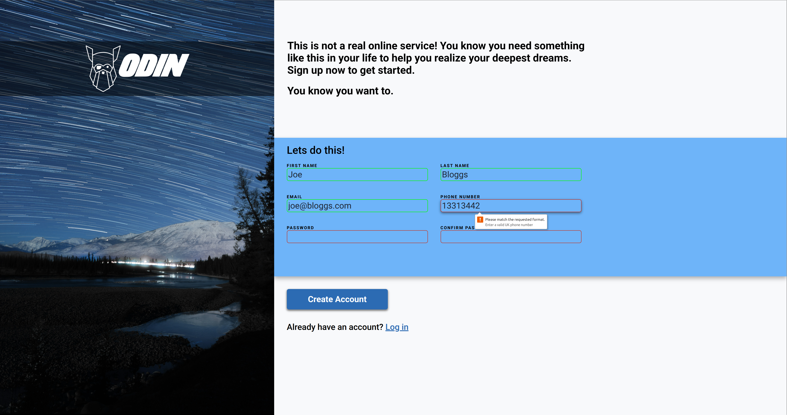

# sign-up-form

A sign-up page for a fictional service, **ODIN**, built with HTML and CSS.
For [The Odin Project](https://www.theodinproject.com)

**Live demo:** <link>

## Built with

- HTML5 and CSS3
- Roboto (Google Fonts)
- Custom Font for ODIN logotype: Longhaul by [James Barnardo](https://www.dafont.com/longhaul.font)
- Blue starry sky background by <a href="https://unsplash.com/@imseason?utm_source=unsplash&utm_medium=referral&utm_content=creditCopyText">Sichen Xiang</a> on <a href="https://unsplash.com/photos/star-trails-over-snowy-mountain-range-hNuj3VEpScw?utm_source=unsplash&utm_medium=referral&utm_content=creditCopyText">Unsplash</a>

 ## Skills Practiced
 - Building an HTML5 form with `label`, input types, and required validation
 - Using CSS custom properties (variables) to size the background image from an aspect ratio
 - Using CSS positioning (`relative` and `absolute`) to overlay the banner on the background image
 - Self-hosting a custom font with `@font-face` (WOFF2) 
 - Loading Roboto from the Google Fonts stylesheet
 - Styling form controls: focus-states, validation states, box-shadows
 - Using a `pattern` regex for phone number validation.
